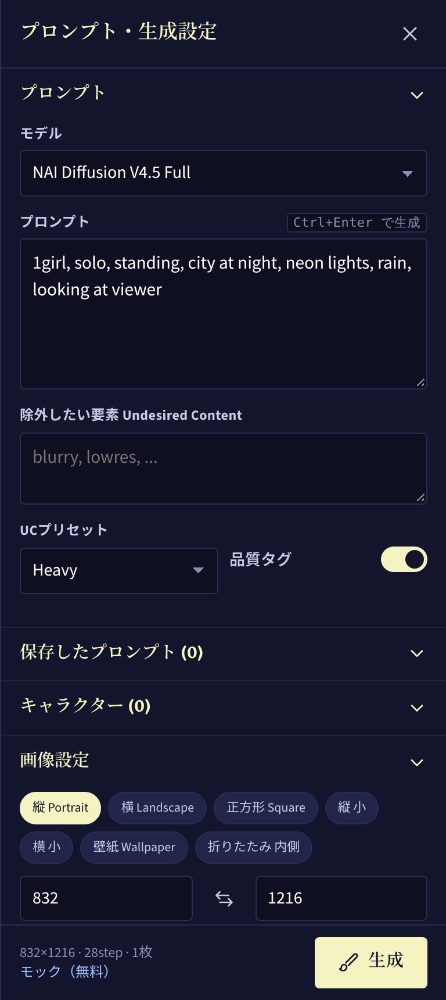

# NAI Fold

**折りたたみスマホ（Galaxy Z Fold など）のために作った、NovelAI 画像生成専用の非公式クライアント。**
開いた状態では **左に生成画像、右にプロンプトと設定** を並べて、画像を見ながらプロンプトを調整できます。

> NovelAI 公式とは関係のない非公式アプリです。使うには NovelAI のアカウントと永続APIトークンが必要です。
> トークンが無くても **モックモード** で全機能の動作を確認できます。

| 開いた状態（左右2画面） | カバー画面 | カバー画面・設定 |
| --- | --- | --- |
|  |  |  |

## 画面構成（自動で切り替わります）

| 状態 | 画面幅の目安 | レイアウト |
| --- | --- | --- |
| カバー画面（閉じた状態） | 〜600px | 画像ビューア＋下部に「プロンプト・設定」「生成」。設定は右から引き出すシート |
| メイン画面（開いた状態） | 600〜1180px | **左右2画面**：左＝ビューア＋サムネイル、右＝プロンプト・生成設定。境目はドラッグで調整（ダブルタップで50:50） |
| フレックスモード（半開き・横向き） | — | **上下2画面**：上＝ビューア、下＝設定（Device Posture API で検出） |
| タブレット・PC | 1180px〜 | 3列（ギャラリー／ビューア／設定） |

- ヒンジ位置が分かる端末（Viewport Segments API）では、境目をヒンジに合わせます。
- 設定 →「表示・レイアウト」から、手動での固定や左右の入れ替えもできます。

## 機能

- モデル：**NAI Diffusion V5 Full / Curated（既定）**、V4.5 Full / Curated、V4 Full / Curated、Anime V3、Furry V3
  - V5 は日本語の文章プロンプトにも対応しています。キャラクタープロンプトは最大22人まで使えます。
  - V5 の品質タグは公式の文字列が公開されていないため、自動では追加しません。
- プロンプト、除外したい要素、UCプリセット、品質タグ（Ctrl+Enter で生成）
- **キャラクタープロンプト（V4以降）**：V4/V4.5は最大6人・V5は最大22人、キャラごとの除外指定、5×5グリッドでの位置指定
- サイズプリセット（折りたたみ内側の画面サイズも含む）／任意サイズ／縦横の入れ替え
- ステップ数、Guidance、CFG Rescale、サンプラー、ノイズスケジュール、シード（固定・ランダム）、枚数（1〜4）、SMEA/DYN（V3）、Variety+（V4）
- **img2img**：ギャラリーの画像かアップロードした画像を元にして生成（強度・ノイズを指定）
- **保存したプロンプト**：プロンプト・除外要素・キャラクターをまとめて保存し、ワンタップで呼び出し
- ギャラリー：すべて／お気に入り、グリッド表示、スワイプで前後の画像へ、タップで拡大
- 画像ごとの操作：保存、お気に入り、この設定を再利用、img2img のベースにする、プロンプトをコピー、削除
- Anlas 残高の表示と消費量の目安（Opus の無料枠も考慮）
- 4種類のテーマ、触覚フィードバック、設定のバックアップと復元
- 画像はすべて端末内（IndexedDB）に保存

## API

| 用途 | エンドポイント |
| --- | --- |
| 画像生成 | `POST https://image.novelai.net/ai/generate-image`（返ってくる ZIP を展開して PNG を取り出す） |
| アカウント | `GET https://api.novelai.net/user/subscription`（プラン・Anlas） |

- 認証には `Authorization: Bearer <永続APIトークン>` を使います。トークンは NovelAI の Account Settings にある *Get Persistent API Token* で取得してください。
- トークンは端末内にだけ保存されます。
- エンドポイントは設定画面から変更できます（プロキシを使う場合など）。
- APIの実装は `src/lib/api/novelai.ts`、モックは `src/lib/api/mock.ts` にあります。API の仕様が変わったときは、ここだけ直せば対応できます。

## 開発

```bash
npm install
npm run dev        # http://localhost:5173 （同じLAN内のスマホからも開けます）
npm test           # ユニットテスト（リクエスト内容・ZIP展開・Anlas計算）
npm run build      # dist/ に出力（PWAとしてそのまま公開できます）
```

## Android アプリ（APK）

```bash
npm run cap:sync   # Web版をビルドして android/ に反映
npm run cap:open   # Android Studio で開いて実行
```

GitHub Actions（`.github/workflows/ci.yml`）が push のたびにテストとビルドを行い、デバッグ用 APK を Artifacts に添付します。

### アプリ版だけの機能

- **写真アプリに直接保存**：保存ボタンを押すと、共有シートを通さずに端末の `Pictures/NAI Fold` アルバムへ保存します（Google フォトや Samsung ギャラリーにそのまま表示されます）。設定で「生成した画像を写真に自動保存」をオンにすると、生成するたびに自動で保存します。他のアプリに送りたいときは「共有」ボタンを使ってください。
  - Android 10 以降は権限なしで保存します。Android 9 以前は初回だけストレージ権限を求めます。
  - 実装：`android/app/src/main/java/dev/naifold/app/GallerySaverPlugin.java`（MediaStore を使用）
- **生成完了の通知**：生成中に別のアプリへ切り替えても、終わったら（失敗したときも）通知します。通知をタップするとアプリに戻ります。Android 13 以降は初回に通知の許可を求めます。設定からオフにもできます。
