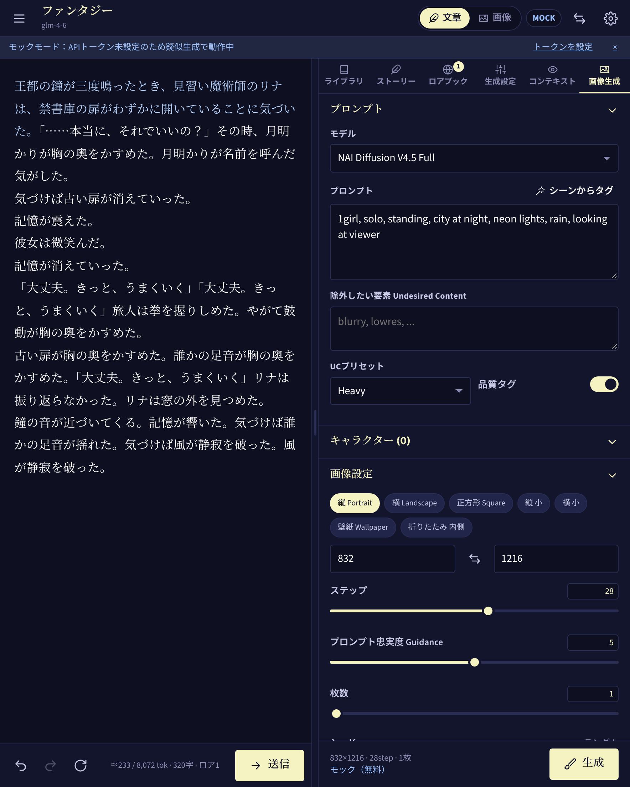
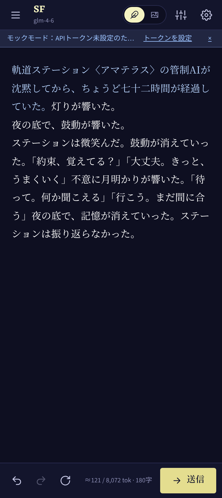
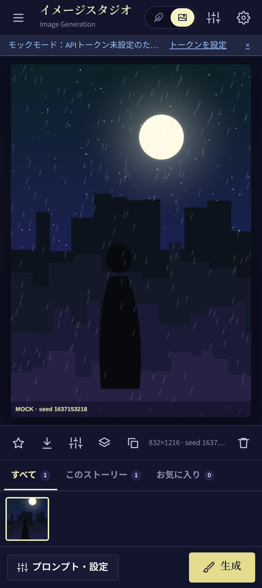

# NAI Fold

**折りたたみスマホ（Galaxy Z Fold など）のために設計した、NovelAI 非公式クライアント。**
左右2画面を活かして、**本文を書きながら隣でメモリー・ロアブック・生成設定・画像生成を同時に操作**できます。

> NovelAI 公式とは無関係の非公式アプリです。利用には NovelAI のアカウントと永続APIトークンが必要です。
> トークンが無くても **モックモード** で全機能の動作を確認できます。

| 開いた状態（左右2画面） | カバー画面 | カバー画面・画像 |
| --- | --- | --- |
|  |  |  |

## 画面構成（自動で切り替わります）

| 状態 | 画面幅の目安 | レイアウト |
| --- | --- | --- |
| カバー画面（閉じた状態） | 〜600px | 1画面。ライブラリは左ドロワー、設定パネルは右シート |
| メイン画面（開いた状態） | 600〜1180px | **左右2画面**：左=エディタ／画像ビューア、右=タブ式パネル。中央の境界はドラッグで調整（ダブルタップで50:50） |
| フレックスモード（半開き・横向き） | — | **上下2画面**：上=エディタ、下=パネル（Device Posture API で検出） |
| タブレット・PC | 1180px〜 | 3カラム（ライブラリ／エディタ／パネル） |

- Viewport Segments API でヒンジが報告される端末では、ペイン境界をヒンジ位置に合わせます。
- 設定 →「表示・レイアウト」で手動固定・左右入れ替えもできます。
- 画面を開閉しても編集中の内容・状態はそのまま引き継がれます。

## 機能

### ストーリー
- オリジナルに倣ったエディタ：プロンプト／ユーザー入力／AI出力／編集を**色分け表示**
- 送信・**リトライ**・元に戻す・やり直し。リトライ結果は**分岐**として保存され、やり直しメニューから選べます
- ストリーミング表示、停止
- **メモリー / 作者の注釈（挿入深さ指定） / ATTG・スタイル行**
- **ロアブック**：キーワード（正規表現 `/…/` 可）・常時有効・検索範囲・優先度・カテゴリ、JSON 入出力。有効化中のエントリは緑で表示
- **コンテキストビューア**：次に送信される内容と各要素のトークン配分を可視化
- 生成設定：モデル（GLM 4.6 / Erato / Kayra / Clio / カスタム）、Temperature、出力長、Top-K/P/A、Min-P、Typical、TFS、各種繰り返しペナルティ、停止シーケンス、禁止文字列、プリセット保存
- 入力欄モード（スマホ向け）、Ctrl+Enter 送信、Ctrl+Shift+R リトライ
- ライブラリ：検索、お気に入り、複製、JSON/テキストの入出力、全データのバックアップ・復元

### イメージスタジオ
- NAI Diffusion V4.5 / V4 / V3 / Furry V3
- プロンプト、除外要素、UCプリセット、品質タグ
- **V4 マルチキャラクタープロンプト**（最大6人、位置指定グリッド）
- サイズプリセット（折りたたみ内側画面サイズ含む）、ステップ、Guidance、CFG Rescale、サンプラー、ノイズスケジュール、シード固定、枚数、SMEA/DYN、Variety+
- **img2img**（ギャラリー画像 or アップロード画像をベースに）
- **シーンからタグ**：ストーリーの直近の場面からテキストモデルでタグを生成
- ギャラリー（すべて／このストーリー／お気に入り）、スワイプで送り、拡大表示、保存、設定の再利用
- Anlas 消費の推定表示（Opus の無料枠も考慮）

**フォールドならではの使い方：** 左で物語を書き、右の「画像生成」タブで「シーンからタグ」→「生成」。挿絵づくりが画面を切り替えずに完結します。

## API について

| 用途 | エンドポイント |
| --- | --- |
| テキスト（GLM 等） | `POST {text}/oa/v1/completions`（OpenAI互換、SSE ストリーミング） |
| テキスト（Erato/Kayra 等） | `POST {text}/ai/generate` / `/ai/generate-stream`（`use_string: true`） |
| 画像 | `POST {image}/ai/generate-image`（ZIP を展開して PNG を取得） |
| アカウント | `GET {api}/user/subscription`（ティア・Anlas） |

- 認証は `Authorization: Bearer <永続APIトークン>`。NovelAI の Account Settings → *Get Persistent API Token* で取得します。
- トークンは端末内（IndexedDB）にのみ保存されます。
- エンドポイントは設定画面から変更可能（プロキシ利用時など）。
- 実装は `src/lib/api/novelai.ts`、モックは `src/lib/api/mock.ts`。API仕様が変わった場合はここだけ直せば済む構成です。

## 開発

```bash
npm install
npm run dev        # http://localhost:5173 （スマホから同一LANでアクセス可）
npm test           # ユニットテスト（文脈構築・履歴・差分・APIペイロード）
npm run build      # dist/ に出力（PWAとしてそのままホスト可能）
```

Chrome DevTools のデバイスエミュレーションで Galaxy Z Fold（カバー 344〜412px / 内側 約884px）を選ぶと各レイアウトを確認できます。

## Android アプリ（APK）

Capacitor でネイティブアプリ化しています（`android/`）。

```bash
npm run cap:sync   # Web をビルドして android/ に反映
npm run cap:open   # Android Studio で開く → Run
```

GitHub Actions（`.github/workflows/ci.yml`）が push のたびにテスト・ビルドし、**デバッグ APK を Artifacts に添付**します。そのままスマホにインストールできます。

- `resizeableActivity` / `adjustResize` 設定済みで、開閉やキーボード表示に追従します。
- アプリ内では画像・ストーリーの保存は共有シート経由になります。

## 構成

```
src/
  lib/            ドメインロジック（UI非依存・テスト対象）
    api/          NovelAI クライアント / モック / SSE パーサ
    context.ts    コンテキスト構築（ATTG→メモリー→ロア→本文＋作者の注釈）
    history.ts    分岐つき Undo/Redo ツリー
    segments.ts   入力元つきテキストと差分適用
    tokens.ts     トークン数推定
    db.ts         IndexedDB ラッパー
  store/          zustand ストア（設定・ストーリー・画像・UI）
  hooks/          useFoldLayout（ヒンジ・姿勢・幅からレイアウト判定）
  components/     画面
android/          Capacitor Android プロジェクト
```
